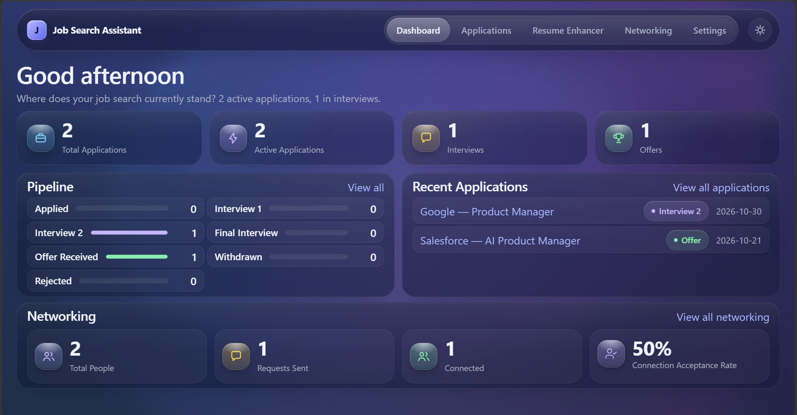
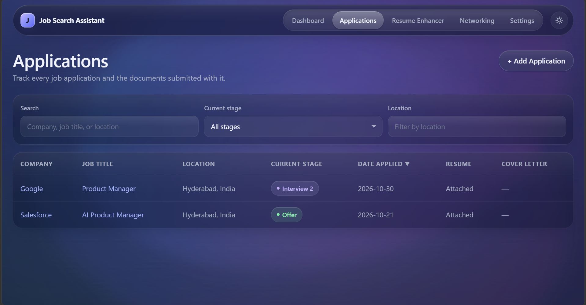
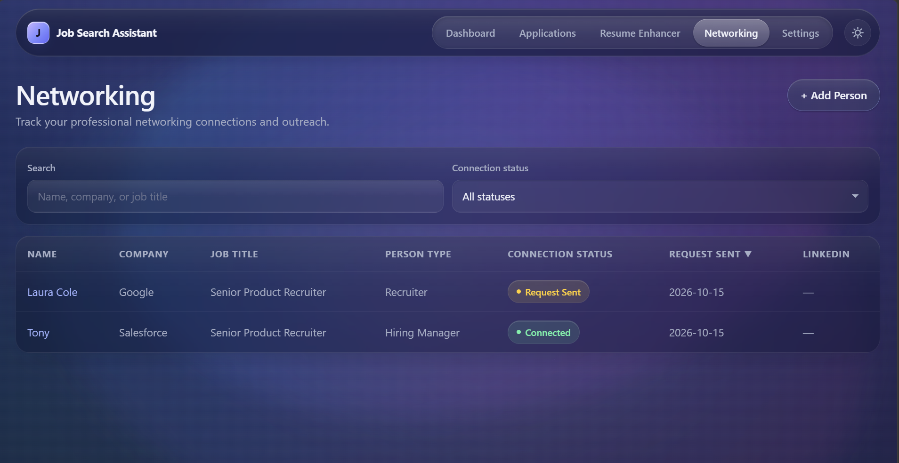
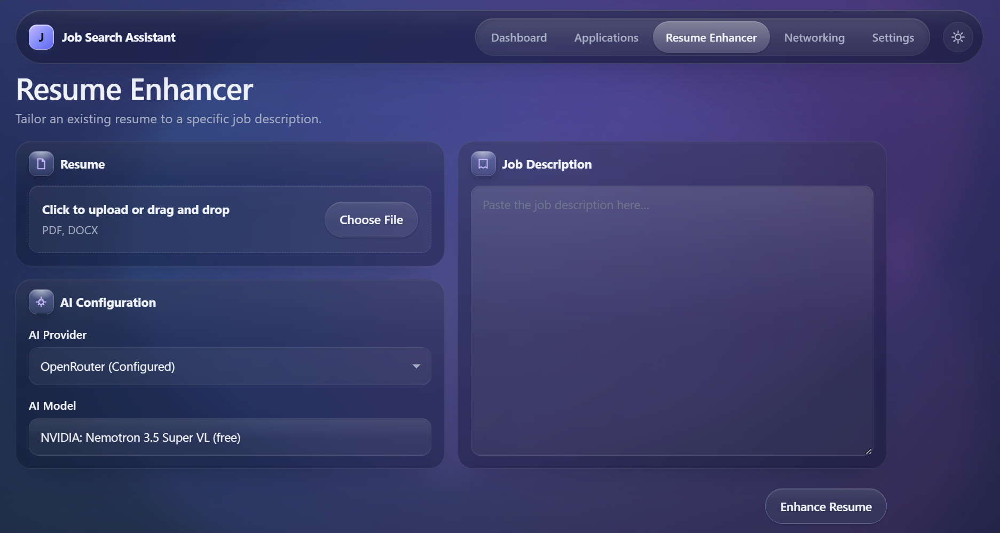
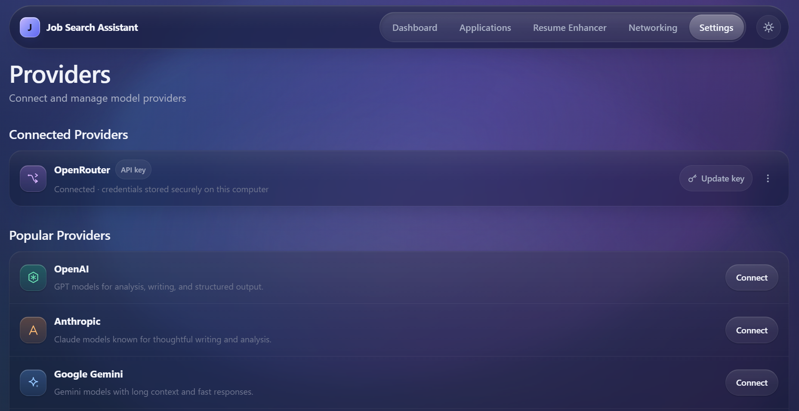

# Job Search Assistant

**A local-first workspace for running a job search as structured data — with a
bring-your-own-key AI Resume Enhancer that proposes reviewable, validated edits
instead of rewriting your resume.**

A job search generates a lot of state: which applications went out and where they
stand, which recruiters and hiring managers you spoke to, which resume version was
used, and what changed between revisions. That state is treated here as structured
data, not as a pile of documents, spreadsheets, or an account held somewhere else.

Job Search Assistant keeps all of it on your machine. A Node.js backend and a React
UI run on `localhost`, structured data lives in SQLite, documents live on disk, and
AI credentials live in your operating system's credential store. AI is optional and
bring-your-own-key: you connect the provider and model you trust, and a request is
made only when you explicitly start an operation.

It is built for individual job seekers; the AI layer is also a concrete example of a
multi-provider workflow with validation, cancellation, and bounded failure handling.

> **Status:** the Resume Enhancer milestone is complete. What is implemented,
> deferred, and out of scope is listed under
> [Roadmap and current status](#roadmap-and-current-status).

## Screenshots

Screenshots use a synthetic demo dataset. No real resume, application, or credential
data is shown.

<table>
  <tr>
    <td width="50%" valign="top">
      
      <br />
      <sub><b>Dashboard</b> — KPIs, pipeline by stage, recent applications, and networking activity, all computed at read time.</sub>
    </td>
    <td width="50%" valign="top">
      
      <br />
      <sub><b>Applications</b> — search and filter by stage or location; each row carries its stage and attached documents.</sub>
    </td>
  </tr>
  <tr>
    <td width="50%" valign="top">
      
      <br />
      <sub><b>People</b> — recruiters, hiring managers, and networking contacts with connection status.</sub>
    </td>
    <td width="50%" valign="top">
      
      <br />
      <sub><b>Resume Enhancer</b> — resume intake, explicit provider and model selection, and the target job description.</sub>
    </td>
  </tr>
  <tr>
    <td colspan="2" align="center" valign="top">
      
      <br />
      <sub><b>Settings → Providers</b> — connect, replace, rename, or remove AI providers.</sub>
    </td>
  </tr>
</table>

## Key features

**Dashboard.** An overview computed from your data rather than stored: total
applications, active applications (excluding Rejected and Withdrawn), interviews
(Interview 1, Interview 2, Final Interview), offers, pipeline counts by stage, recent
applications, and networking totals including an acceptance rate that stays empty
until at least one request has been sent.

**Application tracking.** Company, job title, location, job URL, date applied, current
stage, and notes, with a search box plus stage and location filters. Each application
can carry its own resume and cover-letter attachments. Stages: Applied, Recruiter
Screening, Interview 1, Interview 2, Final Interview, Offer, Rejected, Withdrawn.

**People.** Recruiters, hiring managers, employees, and networking contacts, each with
company, job title, person type, connection status (Identified, Request Sent,
Connected, Not Connected), LinkedIn URL, request-sent date, and notes, searchable and
filterable by status.

**Documents.** Application attachments accept PDF, DOC, and DOCX (15 MB decoded
limit). Files are written to disk beside the database, and SQLite keeps their
metadata. The API exposes only wire-safe metadata, with no filesystem paths. The
Resume Enhancer separately accepts PDF or DOCX uploads, or pasted text, and
converts an upload to plain text at AI operation time.

**Resume Enhancer.** A single-screen workflow: resume plus job description plus an
explicit provider and model produce a structured analysis, targeted suggestions, an
enhanced resume, a generated cover letter, and re-analysis. Long-running work runs on
the backend with live stage progress and a Stop control that actually cancels.

**AI provider management.** Connect a provider with your own API key, replace a key,
rename a provider's display label, or remove a provider and its credential
individually. Provider and model are chosen per operation, with no hidden global
default.

## AI capabilities

Every AI operation is explicit and reviewable. The backend owns all provider calls;
the browser never sees a credential or a raw provider response.

### Analysis and job-description matching

- **Structured analysis** of a resume against one specific job description: overall
  match, an AI-estimated ATS score, key strengths, key gaps, and a role-alignment
  assessment that can flag a genuine role mismatch instead of forcing an enhancement.
- **Suggestions** are generated for the gaps the analysis identified, not for generic
  resume advice.
- **Cover-letter generation** and **re-analysis** work from the same resume and job
  context within a session.

### Enhancement as a validated patch

This is the core design decision behind the Resume Enhancer:

1. Each session has exactly one immutable **BaseResume** — the canonical text the
   model is allowed to work from.
2. The model does not return a rewritten document. It returns a targeted
   **ResumePatch** describing specific edits.
3. The server validates that patch and applies it against the untouched base. Any
   section you did not ask to change stays byte-identical.
4. The change summary you see is derived from the patch that was actually applied,
   not written by the model.

In plain terms: the AI proposes edits, the server decides what is structurally valid,
and the original base text is preserved, so nothing is silently replaced.

### Multi-provider architecture

One provider contract, five adapters, so no feature depends on a specific vendor:

| Provider | Integration |
| --- | --- |
| OpenAI | chat-completions adapter |
| Anthropic | messages API adapter |
| Google Gemini | generate-content adapter |
| DeepSeek | OpenAI-compatible chat adapter |
| OpenRouter | gateway with dynamic model discovery and capability mapping, including a prompted-JSON tier so free and limited models remain selectable |

- **Explicit selection.** Provider and model are chosen per operation. An
  unconfigured or stale choice produces a safe start error rather than a silent
  fallback to some default model.
- **Capability-aware requests.** Every AI operation requires structured output, and
  adapters declare which structured-output and reasoning capabilities they support.
  The server picks the request shape — `json_schema` where the provider enforces a
  schema, `json_object` for the provider's JSON mode, or `prompted_json` where the
  schema is described in the prompt — and bounds the reasoning budget so a reasoning
  model cannot consume the whole completion.
- **No retrieval layer.** Prompts are assembled from the resume, the job description,
  and the operation's structured context; there is no RAG or vector store to explain
  away a bad answer.

### Validation, retries, and cancellation

- **Per-request timeouts** cover headers and body, so a hanging provider fails fast.
- **Bounded retry:** at most two attempts in total, separated by an abort-aware 250 ms
  delay, with no exponential backoff.
- **Real cancellation:** Stop aborts the in-flight provider request, discards the
  incomplete attempt, and restores the intake for a retry.
- **Progress you can watch:** work is executed server-side and progress is polled with
  live stage reporting; navigation is locked while a stage is preparing or running.
- **Sanitized failures:** HTTP errors, timeouts, truncation, refusals, and invalid
  responses are normalized into safe application errors, each with its own distinct
  message. Provider HTTP, transport, and timeout failures additionally carry the
  sanitized diagnostics fields `providerStatus`, `failureCategory`, and `retryable`.
  Provider response bodies, headers, and credentials are never surfaced in the UI or
  written to logs.
- **No live key validation, by design.** A key is exercised by the first real
  operation, so connecting a provider never sends a test request.

## Architecture and technology stack

A local-first modular monolith: one Node.js process serving a JSON API, one React
single-page application, and one SQLite database. No cloud services, no accounts, no
background workers, and no message queue.

```text
Browser (React SPA)  ── HTTP/JSON ──►  Local Node backend (127.0.0.1:3001)
                                            │
                                            ├──► SQLite (node:sqlite) + local files
                                            │
                                            └──► Your AI provider (HTTPS, only while
                                                 an operation you started is running)
```

```text
src/                     React SPA: features, routing, shared UI
  features/              applications · dashboard · people · resume-enhancer · settings
  components/common/     shared form, dialog, model-select, and status components
server/
  http/                  routing, JSON handling, body limits, error mapping
  modules/               applications · dashboard · people · documents · enhancements · ai
    ai/                  provider adapters, credential stores, execution engine
  database/migrations/   ordered SQL migrations (001–006) applied at startup
shared/domain/           domain contracts shared by client and server
tests/                   node:test suites: backend, contracts, SSR and jsdom components
docs/                    product specification, architecture, ADRs, implementation status
```

In development, the browser talks to Vite, which proxies `/api` to the backend; the
backend dispatches to a feature module, which reads and writes SQLite or the local
document store. AI calls originate only from the backend.

| Layer | Choice |
| --- | --- |
| Frontend | React 19.2, React Router 8.3, TypeScript ~6.0, Vite 8.2 |
| Backend | Node.js `>=22.13`, TypeScript, `node:http`, `node:sqlite` |
| Persistence | SQLite with ordered schema migrations, plus files on disk for application and enhancement artifacts |
| AI | Five provider adapters behind one contract, per-operation model selection, in-process polling execution engine |
| Resume Enhancer text extraction | `unpdf` for PDF, `mammoth` for DOCX |
| Credentials | OS-native stores: Windows Credential Manager (in-process via `koffi`), macOS Keychain (`security`), Linux Secret Service (`secret-tool`) |
| Quality | `oxlint`, `node:test` via `tsx` (30 test files, including server-rendered and jsdom component tests), GitHub Actions |

**Testing and CI.** `npm test` runs the `node:test` suites through `tsx`; tests use an
isolated temporary data directory and in-memory credential stores, so no real
credential or user database is touched. The GitHub Actions workflow runs on pushes to
`main` and on pull requests: `npm ci`, lint, tests, backend type-check
(`tsc -p tsconfig.server.json --noEmit`), frontend type-check
(`tsc -b tsconfig.app.json tsconfig.node.json`), then the production build.

## Security and privacy

This is a local-first design, not a claim of absolute privacy or security.

**Where your data lives.** On startup the backend resolves an application data
directory, applies pending migrations, and opens the database:

| Platform | Data directory |
| --- | --- |
| Windows | `%APPDATA%\Job Search Assistant\` |
| macOS | `~/Library/Application Support/Job Search Assistant/` |
| Linux | `$XDG_DATA_HOME/job-search-assistant/` or `~/.local/share/job-search-assistant/` |

It contains the SQLite database at `database/job-search-assistant.db`, plus
`documents/applications/` and `documents/enhancements/` for file artifacts. Set
`JOB_SEARCH_ASSISTANT_DATA_DIR` to override the location. Runtime data is never stored
inside the repository.

**How credentials are stored.** API keys are held only by the operating system's
credential store — Windows Credential Manager (via `koffi`), macOS Keychain, or Linux
Secret Service — namespaced per provider. There is no plaintext fallback: if the
secure store is unavailable, AI features report a configuration error instead of
degrading. Keys are write-only from the application's perspective (never returned by
the API, never redisplayed after saving), and the AI execution layer is the only code
that reads one, only at execution time.

**What leaves your machine.** The workspace is local, but AI processing is not. When
you run an operation, your resume and job description are sent to the provider you
selected and are governed by that provider's terms; the app states this before use.
The backend binds to `127.0.0.1` and has no authentication, because it is built for a
single local user — it is not designed to be exposed to a network or the internet.

## Getting started

**Prerequisites:** Node.js 22.13 or later (the CI workflow uses Node 24) and npm.

```bash
npm install
npm run dev
```

`npm run dev` starts the backend in watch mode, waits for `GET /api/health` to
succeed, and only then starts Vite — so the first page load cannot race the API.

- Frontend (Vite): `http://localhost:5173`
- Backend: `http://127.0.0.1:3001`

Then open **Settings → Providers**, connect a provider with your own API key, and go
to **Resume Enhancer**.

| Script | Purpose |
| --- | --- |
| `npm run dev` | Backend (watch) and Vite, gated on backend readiness |
| `npm run build` | Type-check and build the backend to `dist-server/` and the frontend to `dist/` |
| `npm run preview` | Serve the built frontend with Vite preview |
| `npm test` | Full `node:test` suite via `tsx` |
| `npm run lint` | `oxlint` |

`npm run dev` composes the individual `dev:server`, `dev:wait-for-backend`, and
`dev:web` scripts if you need to run one part on its own.

**Configuration.** `JOB_SEARCH_ASSISTANT_DATA_DIR` relocates the data directory
(used by the test suite to keep each run isolated). AI credentials are not part of
application configuration: they are entered in Settings → Providers and stored by the
operating system's credential store, never in the repository or a config file.

## Project documentation

Product behavior and technical design are documented separately so decisions stay
traceable:

- [System architecture](docs/architecture/SYSTEM_ARCHITECTURE.md) — components,
  boundaries, and request flow.
- [AI architecture](docs/architecture/AI_ARCHITECTURE.md) — provider contract,
  execution engine, and failure handling.
- [Security model](docs/architecture/SECURITY.md) — data locations, credential
  handling, and trust boundaries.
- [Architecture decision records](docs/architecture/ADRs/) — the reasoning behind the
  local-first monolith, SQLite, provider abstraction, BaseResume/ResumePatch,
  cancellation, bounded retry, and the role-mismatch guard.
- [Implementation status](docs/IMPLEMENTATION_STATUS.md) — milestone history with
  validation evidence.
- [Product vision](docs/product/PRODUCT_VISION.md) and
  [product principles](docs/product/PRODUCT_PRINCIPLES.md) — the product intent
  behind the feature set.

## Roadmap and current status

**Implemented and validated:** Applications, People, Documents, the computed
Dashboard, secure multi-provider AI configuration, the Resume Enhancer workflow end to
end (analysis, suggestions, patch-based enhancement, cover letter, re-analysis, Stop),
and provider management in Settings.

**Planned or not implemented yet:**

- DOCX and PDF generation and download of enhanced resumes and cover letters.
- Carrying an enhanced resume or cover letter into an application.
- Retaining and revisiting past enhancement sessions beyond the retention window.
- Desktop packaging (Electron) as a possible future distribution option. The app
  currently runs as a local web application with a local backend; no packaged desktop
  build exists.

**Explicitly out of scope:** multi-user support, sync, and cloud deployment. The
backend is intentionally single-user and unauthenticated on `127.0.0.1`.

**Known limitations:** AI features need your own provider key and are billed by that
provider; model catalogs and capability tiers vary by provider and change upstream;
AI output is reviewable but not guaranteed correct, which is why enhancements arrive
as a patch over your original document rather than a replacement.

## License

MIT — see [LICENSE](LICENSE). Copyright (c) 2026 shaikm32.
